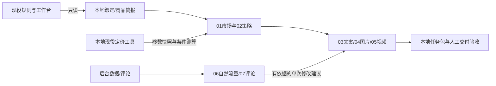

# Sovyn MY 专属工具箱首版设计

状态：用户2026-10-16确认按对话方案执行；本文落实范围，不新增生成/费用/发布权限。

目标：把七个可复用运营模块适配到TikTok Shop MY宠物业务，引用本地权威规则，用同一商品资料完成准备、校验及复盘交接。

## 结构与数据流

仓库保存提示词、输入输出契约、可移植配置和标准库命令。业务数据、实际来源哈希、绝对路径和真实案例留Git忽略的`.local/`。上游全文转入`reference/upstream/`保留引用关系和许可证，阻止旧规则成为默认入口。

## 边界与取舍

- 选用配置+文档+小型本地命令；不新建Web界面、数据库、队列、平台API或模型调用服务。
- 七模块均可独立读取；首版主路径为自然流量。广告能力只作可选参考。
- 本地业务文档唯一权威，不复制维护第二套费率/工作台/全文SOP。配置保存文档路由；doctor每次校验并报告来源变化。
- 命令生成给现有智能体的任务输入包，不伪称自动完成AI推理、图片/视频生成、视觉验收、销售验证或上架。
- 当前实物尺寸、供货/费用和后台未知项保持未知。已有图文可支持的任务继续，缺证的定价/适配方向停止。

## 验收

1. 上游来源、基线commit、许可证和本地branch可追溯。
2. 七模块输入/输出、证据状态、阻塞点和回流对象完整；活跃入口无巴西站固定阈值、九图或广告必做。
3. 能只读定位工作台表头与商品，不根据行号/文件夹号假配PET；生成任务包引用当前权威文档的哈希与节选。
4. 零和缺失、指标分母和周期正确；数据口径不一致时拒绝计算，不推断限流。
5. 计价读取现役保存参数，不更改正式DB；调用既有计算内核，不另造费用默认值。
6. 实际商品本地演练记录完整；真实经营缺口不得写“通过”。正式工作簿、计价DB及原图哈希前后一致。
7. 真实数据未被Git追踪；输出越界和覆盖被拒绝；测试及命令退出结果可复验。

回滚：保留上游commit，切回上游即可查看原版本；删除/归档专属目录不影响外部业务项目。真实数据清理由用户决定。远程fork若无法创建，单列阻塞，不冒称完成。
